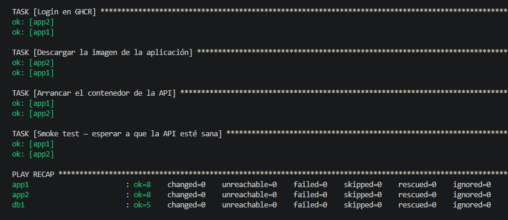
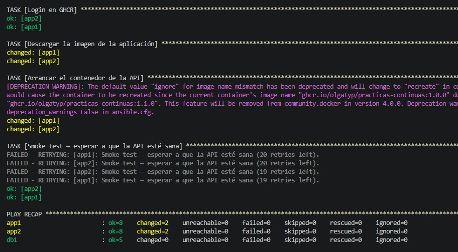
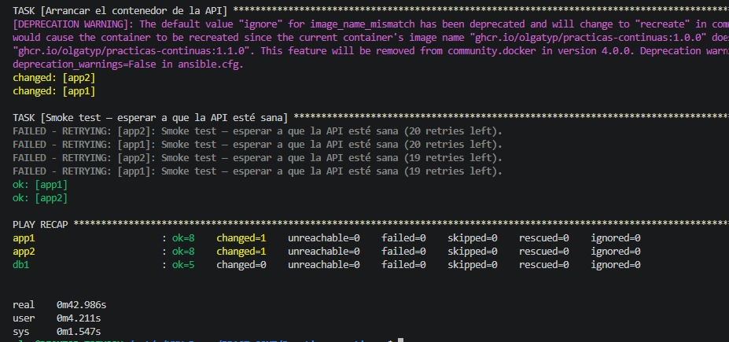
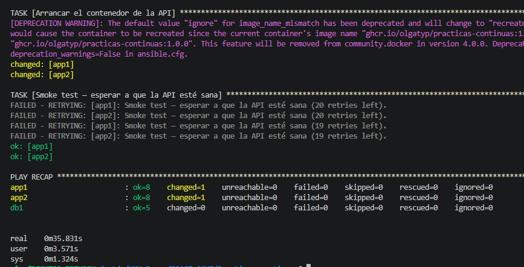
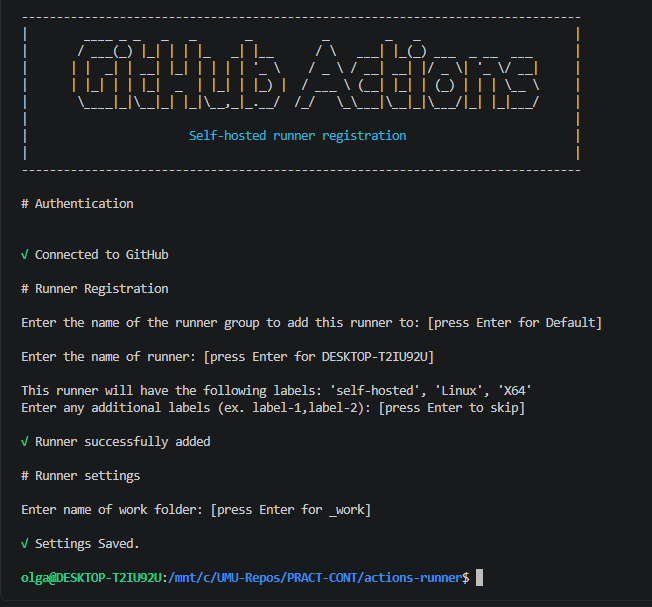
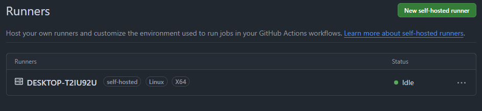
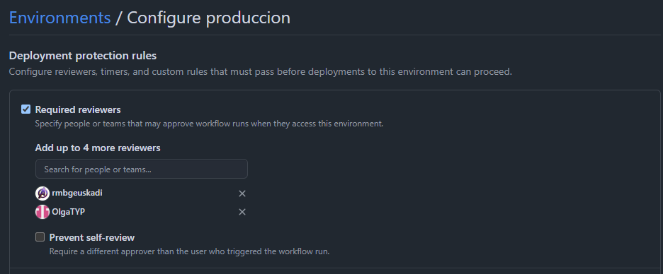
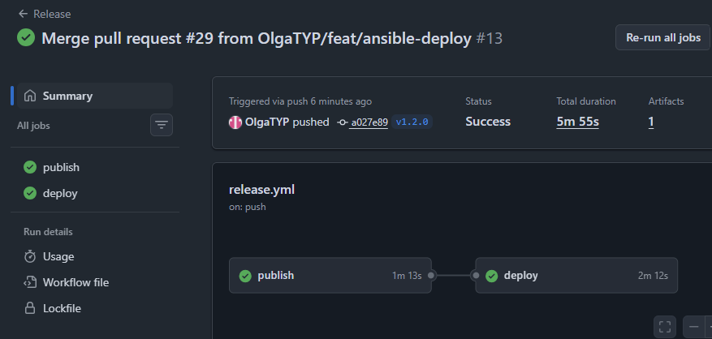

# Boletín 6: Despliegue con Ansible

> Pareja: Olga Yanes ([@OlgaTYP](https://github.com/OlgaTYP)) y Roxana Bareiro ([@rmbgeuskadi](https://github.com/rmbgeuskadi)).
> Repositorio: [OlgaTYP/Practicas-continuas](https://github.com/OlgaTYP/Practicas-continuas)

## Resumen de commits

| #   | Mensaje del commit                                                  | Qué se hizo                                                                                                                                                        | Autor          | Enlace                                                                   |
| --- | ------------------------------------------------------------------- | ------------------------------------------------------------------------------------------------------------------------------------------------------------------ | -------------- | ------------------------------------------------------------------------ |
| 1   | `feat(ansible): añadir dependencias de despliegue`                  | `deploy/requirements.yml` con la collection `community.docker` 3.7.0.                                                                                              | Roxana Bareiro | [5d1fb52](https://github.com/OlgaTYP/Practicas-continuas/commit/5d1fb52) |
| 2   | `feat(deploy): añade flota de servidores destino (app1, app2, db1)` | `deploy/servidores/docker-compose.yml` con las tres «máquinas» con SSH.                                                                                            | OlgaTYP        | [7498c87](https://github.com/OlgaTYP/Practicas-continuas/commit/7498c87) |
| 3   | `feat(ansible): configurar inventario de servidores`                | `deploy/inventory.ini` con los grupos `app`, `db` y `servidores`.                                                                                                  | Roxana Bareiro | [d88fe55](https://github.com/OlgaTYP/Practicas-continuas/commit/d88fe55) |
| 4   | `feat(ansible): configurar despliegue de la aplicación`             | `deploy/deploy.yml`, el playbook de tres plays: Docker en toda la flota, PostgreSQL en `db` y la API en `app`.                                                     | Roxana Bareiro | [156cd01](https://github.com/OlgaTYP/Practicas-continuas/commit/156cd01) |
| 5   | `feat(deploy): añade credenciales cifradas con Ansible Vault`       | `deploy/group_vars/servidores/vault.yml`, cifrado con Ansible Vault.                                                                                               | OlgaTYP        | [49e0b71](https://github.com/OlgaTYP/Practicas-continuas/commit/49e0b71) |
| —   | `Merge pull request #25 from OlgaTYP/feat/ansible-deploy`           | Integración en `main` de los commits 1 a 5 mediante el [PR #25](https://github.com/OlgaTYP/Practicas-continuas/pull/25), aprobado por rmbgeuskadi.                 | rmbgeuskadi    | [fbbfb10](https://github.com/OlgaTYP/Practicas-continuas/commit/fbbfb10) |
| 6   | `feat: automatizar despliegue con self-hosted runner`               | Job `deploy` en `.github/workflows/release.yml` y `outputs` en el job `publish`.                                                                                   | Roxana Bareiro | [c12e936](https://github.com/OlgaTYP/Practicas-continuas/commit/c12e936) |
| —   | `Merge branch 'main' into feat/ansible-deploy`                      | Actualización de la rama con `main` antes de fusionar.                                                                                                             | OlgaTYP        | [17e8438](https://github.com/OlgaTYP/Practicas-continuas/commit/17e8438) |
| —   | `Merge pull request #29 from OlgaTYP/feat/ansible-deploy`           | Integración en `main` del commit 6 mediante el [PR #29](https://github.com/OlgaTYP/Practicas-continuas/pull/29), aprobado por rmbgeuskadi y fusionado por OlgaTYP. | OlgaTYP        | [a027e89](https://github.com/OlgaTYP/Practicas-continuas/commit/a027e89) |

Además de los commits, en este boletín se crearon:

| Elemento                 | Qué es                                                                                                                        | Enlace                                                               |
| ------------------------ | ----------------------------------------------------------------------------------------------------------------------------- | -------------------------------------------------------------------- |
| Etiqueta `v1.1.0`        | Etiqueta sobre `fbbfb10` (merge del PR #25). Publica la imagen `1.1.0`, usada para el cambio de versión y el rollback a mano. | [v1.1.0](https://github.com/OlgaTYP/Practicas-continuas/tree/v1.1.0) |
| Etiqueta `v1.2.0`        | Etiqueta sobre `a027e89` (merge del PR #29). Primera versión desplegada de extremo a extremo por GitHub Actions.              | [v1.2.0](https://github.com/OlgaTYP/Practicas-continuas/tree/v1.2.0) |
| Runner `DESKTOP-T2IU92U` | Runner autoalojado en el ordenador de OlgaTYP (WSL2), con las etiquetas `self-hosted`, `Linux` y `X64`.                       | Settings → Actions → Runners                                         |
| Entorno `produccion`     | Entorno protegido con _Required reviewers_ (rmbgeuskadi y OlgaTYP) y el secret `VAULT_PASS`.                                  | Settings → Environments                                              |

## Detalle por commit

### 1. `feat(ansible): añadir dependencias de despliegue`

- **Qué se hizo:** se creó `deploy/requirements.yml`, que declara la collection `community.docker` en la versión exacta `3.7.0`. Así cualquiera (y el runner de la Parte G) instala lo mismo con `ansible-galaxy collection install -r deploy/requirements.yml`.
- **Autor:** Roxana Bareiro
- **Relación con el boletín:** Parte A.
- **Uso de IA:** No se ha utilizado la IA

### 2. `feat(deploy): añade flota de servidores destino (app1, app2, db1)`

- **Qué se hizo:** se creó `deploy/servidores/docker-compose.yml` con tres contenedores `rastasheep/ubuntu-sshd:18.04` en modo `privileged`: `app1` (SSH en 2223, API en 8081), `app2` (SSH en 2224, API en 8082) y `db1` (SSH en 2225).
- **Autor:** OlgaTYP
- **Relación con el boletín:** Parte B.
- **Uso de IA:** No se ha utilizado la IA

### 3. `feat(ansible): configurar inventario de servidores`

- **Qué se hizo:** se creó `deploy/inventory.ini` con el grupo `app` (`app1`, `app2`), el grupo `db` (`db1`) y el grupo padre `servidores`, que reúne a los dos y define las variables de conexión comunes.
- **Autor:** Roxana Bareiro
- **Relación con el boletín:** Parte C.
- **Uso de IA:** No se ha utilizado la IA

### 4. `feat(ansible): configurar despliegue de la aplicación`

- **Qué se hizo:** se creó `deploy/deploy.yml` con los tres plays del enunciado. La imagen apunta a `ghcr.io/olgatyp/practicas-continuas`, que es el nombre con el que el Boletín 5 publica la imagen en GHCR.
- **Autor:** Roxana Bareiro
- **Relación con el boletín:** Parte D.
- **Uso de IA:** No se ha utilizado la IA

### 5. `feat(deploy): añade credenciales cifradas con Ansible Vault`

- **Qué se hizo:** se añadió `deploy/group_vars/servidores/vault.yml`, creado con `ansible-vault create`. Contiene `ghcr_user`, `ghcr_token`, `db_name`, `db_user` y `db_pass`, y en el repositorio solo se ve el texto cifrado.
- **Autor:** OlgaTYP
- **Relación con el boletín:** Parte E.
- **Uso de IA:** No se ha utilizado la IA

### 6. `feat: automatizar despliegue con self-hosted runner`

- **Qué se hizo:** se amplió `.github/workflows/release.yml`. El job `publish` expone la versión publicada como `outputs.version` y se añadió el job `deploy`, que se ejecuta en el runner autoalojado, dentro del entorno `produccion`, solo cuando el push es de una etiqueta `v*`.
- **Autor:** Roxana Bareiro
- **Relación con el boletín:** Parte G.
- **Uso de IA:** No se ha utilizado la IA

## Descripción narrativa de lo hecho en la sesión y relación con los commits

El trabajo de terminal se hizo en WSL2 (Ubuntu 24.04) sobre el ordenador de OlgaTYP (`DESKTOP-T2IU92U`), con Docker Desktop como motor de contenedores. Ese mismo ordenador hace de controlador de Ansible y, en la Parte G, de runner de GitHub Actions.

### Parte A — Instalar Ansible y sus dependencias

Se instaló Ansible con `apt` en Ubuntu 24.04, que trae la versión 2.16.3, y después la collection de Docker:

```bash
ansible --version
ansible-galaxy collection install community.docker:3.7.0
```

Versiones instaladas en el controlador:

```text
ansible [core 2.16.3]
community.docker 3.7.0
```

La dependencia quedó declarada en el repositorio ([5d1fb52](https://github.com/OlgaTYP/Practicas-continuas/commit/5d1fb52)) para que la instalación sea reproducible:

```yaml
# deploy/requirements.yml
collections:
  - name: community.docker
    version: "3.7.0"
# se instala con: ansible-galaxy collection install -r deploy/requirements.yml
```

### Parte B — Preparar la flota de servidores destino

Se creó `deploy/servidores/docker-compose.yml` ([7498c87](https://github.com/OlgaTYP/Practicas-continuas/commit/7498c87)) tal y como lo da el enunciado: tres contenedores Ubuntu con `sshd` que hacen de servidores. Son `privileged` porque dentro de cada uno se ejecutará su propio Docker.

| Máquina | Grupo | Puerto SSH en el anfitrión | Puerto de la API en el anfitrión |
| ------- | ----- | -------------------------- | -------------------------------- |
| `app1`  | `app` | 2223                       | 8081 → 8080                      |
| `app2`  | `app` | 2224                       | 8082 → 8080                      |
| `db1`   | `db`  | 2225                       | —                                |

Se levantó la flota y se comprobó la entrada manual por SSH en las tres máquinas (`ssh root@localhost -p 2223`, `-p 2224` y `-p 2225`, contraseña `root`) antes de usar Ansible:

```bash
docker compose -f deploy/servidores/docker-compose.yml up -d
```

Estado de la flota en el anfitrión:

```text
NAMES   IMAGE                          PORTS
app1    rastasheep/ubuntu-sshd:18.04   0.0.0.0:2223->22/tcp, 0.0.0.0:8081->8080/tcp
app2    rastasheep/ubuntu-sshd:18.04   0.0.0.0:2224->22/tcp, 0.0.0.0:8082->8080/tcp
db1     rastasheep/ubuntu-sshd:18.04   0.0.0.0:2225->22/tcp
```

### Parte C — El inventario

`deploy/inventory.ini` ([d88fe55](https://github.com/OlgaTYP/Practicas-continuas/commit/d88fe55)) agrupa las máquinas por rol. Las tres se alcanzan por `localhost`, cada una en su puerto SSH, y el grupo `servidores:children` permite dirigir tareas a la flota entera:

```ini
[app]
app1 ansible_host=localhost ansible_port=2223 ansible_user=root
app2 ansible_host=localhost ansible_port=2224 ansible_user=root

[db]
db1 ansible_host=localhost ansible_port=2225 ansible_user=root

[servidores:children]
app
db

[servidores:vars]
ansible_python_interpreter=/usr/bin/python3
ansible_password=root
ansible_ssh_common_args='-o StrictHostKeyChecking=no -o UserKnownHostsFile=/dev/null'
```

Con `sshpass` instalado (`sudo apt install -y sshpass`), se verificó la conexión con el módulo `ping` y las tres máquinas respondieron `pong`:

```bash
ansible -i deploy/inventory.ini servidores -m ping
```

`StrictHostKeyChecking=no` y `UserKnownHostsFile=/dev/null` evitan que SSH pida confirmar la huella de cada máquina, que además cambia cada vez que se recrean los contenedores. Es aceptable en este entorno de prácticas, pero no en servidores reales.

### Parte D — El playbook de despliegue

`deploy/deploy.yml` ([156cd01](https://github.com/OlgaTYP/Practicas-continuas/commit/156cd01)) tiene tres plays, cada uno dirigido a un grupo del inventario:

| Play                             | Hosts        | Qué hace                                                                                                                                                                         |
| -------------------------------- | ------------ | -------------------------------------------------------------------------------------------------------------------------------------------------------------------------------- |
| Preparar Docker en toda la flota | `servidores` | Instala `docker.io` y `python3-docker` y arranca `dockerd` a mano, porque los contenedores no tienen systemd. `creates: /var/run/docker.pid` hace que no se relance si ya corre. |
| Desplegar la base de datos       | `db`         | Contenedor `tareas-db` con `postgres:16`, volumen `tareas-db-data`, `healthcheck` con `pg_isready` y `network_mode: host`.                                                       |
| Desplegar la API de tareas       | `app`        | Login en GHCR, descarga de la imagen, contenedor `tareas-api` con `network_mode: host` y _smoke test_ contra `/actuator/health`.                                                 |

El único cambio respecto al enunciado es el nombre de la imagen, que es el que se publicó en el Boletín 5:

```yaml
- name: Desplegar la API de tareas
  hosts: app
  vars:
    version_app: "1.0.0" # se sobreescribe desde el CI
    imagen: "ghcr.io/olgatyp/practicas-continuas:{{ version_app }}"
    host_bd: "{{ groups['db'][0] }}" # primer host del grupo db
```

La versión se despliega siempre por un tag inmutable (`1.0.0`, `1.1.0`, `1.2.0`) y nunca por `latest`.

La API llega a la base de datos por el nombre de host `db1` (`host_bd`, el primer host del grupo `db`) gracias a `network_mode: host`. El contenedor comparte la red de su «máquina» y resuelve `db1` igual que ella. Las credenciales (`ghcr_user`, `ghcr_token`, `db_name`, `db_user`, `db_pass`) no aparecen en el playbook: salen del Vault de la Parte E.

### Parte E — Proteger las credenciales con Ansible Vault

Se creó el fichero cifrado con `ansible-vault create deploy/group_vars/servidores/vault.yml` ([49e0b71](https://github.com/OlgaTYP/Practicas-continuas/commit/49e0b71)) con las cinco variables del enunciado. Al estar en `group_vars/servidores/`, Ansible lo carga automáticamente para todos los hosts del grupo `servidores`.

Con `cat` se comprueba que el fichero versionado es ilegible. Solo se ve la cabecera del Vault y el texto cifrado:

```text
$ cat deploy/group_vars/servidores/vault.yml
$ANSIBLE_VAULT;1.1;AES256
65663362396134653063386632666164333031383162643164373434306533616633336438636438
6464373965383932393462373337343031373034643139370a356431663366316536663861306633
...
```

Una consecuencia de esto es que, desde que existe el Vault, cualquier comando de Ansible sobre el inventario necesita la contraseña, incluso un simple `ping`. Sin ella falla al cargar `group_vars`:

```text
$ ansible -i deploy/inventory.ini servidores -m ping
ERROR! Attempting to decrypt but no vault secrets found
```

Por eso todos los comandos siguientes llevan `--ask-vault-pass` en local o `--vault-password-file` en el CI.

### Parte F — Ejecutar el despliegue a mano

#### 1. Primer despliegue y comprobación de las dos réplicas

Se lanzó el playbook contra toda la flota con la versión `1.0.0`:

```bash
ansible-playbook -i deploy/inventory.ini deploy/deploy.yml \
  --ask-vault-pass --extra-vars "version_app=1.0.0"
```

Y se comprobó que las dos réplicas responden a la API, ambas contra la misma base de datos de `db1`:

```bash
curl http://localhost:8081/api/tasks   # app1
curl http://localhost:8082/api/tasks   # app2
```

Las dos réplicas responden con la API desplegada por Ansible. La lista de tareas está vacía porque la base de datos de `db1` es nueva:

![curl a localhost:8081/api/tasks (app1) y a localhost:8082/api/tasks (app2): las dos devuelven []](img/boletin6/curl-replicas.jpeg)

#### 2. Idempotencia

Se relanzó el mismo playbook sin cambiar nada. Docker ya estaba instalado y arrancado, PostgreSQL ya corría y el contenedor de la API ya tenía la versión `1.0.0`, así que Ansible no tuvo nada que corregir: todas las tareas terminan en `ok` y el resumen muestra `changed=0` en `app1`, `app2` y `db1`.



#### 3. Desplegar una versión nueva (`1.1.0`)

Se creó la etiqueta `v1.1.0` sobre el merge del PR #25 ([fbbfb10](https://github.com/OlgaTYP/Practicas-continuas/commit/fbbfb10)) y el workflow `Release` del Boletín 5 publicó la imagen `1.1.0` ([ejecución](https://github.com/OlgaTYP/Practicas-continuas/actions/runs/40378544309)). En ese momento el workflow aún no tenía el job `deploy`, así que se desplegó a mano:

```bash
ansible-playbook -i deploy/inventory.ini deploy/deploy.yml \
  --ask-vault-pass --extra-vars "version_app=1.1.0"
```

Esta vez sí hubo cambios, solo en las réplicas de la aplicación: `changed=2` en `app1` y `app2` (descarga de la imagen nueva y recreación del contenedor) y `changed=0` en `db1`.



En la salida se ven dos detalles:

- **El aviso de `image_name_mismatch`.** El playbook usa `recreate: false`, pero el contenedor se recrea igualmente porque la imagen pedida (`:1.1.0`) no es la que tiene (`:1.0.0`). `recreate: false` solo evita recrearlo cuando nada ha cambiado. El aviso indica que en `community.docker` 4.0.0 el valor por defecto pasará a ser `recreate`. Con la collection fijada a 3.7.0 no afecta, pero habrá que tenerlo en cuenta al actualizarla.
- **Los reintentos del *smoke test*.** Las dos primeras comprobaciones de `/actuator/health` fallan (`FAILED - RETRYING`) mientras Spring Boot arranca, y la tercera ya devuelve `UP`. Por eso la tarea usa `retries` y `until`.

La imagen `1.1.0` se construyó desde `fbbfb10`, que solo añade la carpeta `deploy/` respecto a `1.0.0`. La API responde igual en las dos versiones; lo que se comprueba aquí es que Ansible detecta el cambio de tag y actualiza las dos réplicas. La primera versión con cambios visibles en la API es la `1.2.0` de la Parte G.

#### 4. Rollback a `1.0.0`

Se volvió atrás relanzando el playbook con la versión anterior:

```bash
ansible-playbook -i deploy/inventory.ini deploy/deploy.yml \
  --ask-vault-pass --extra-vars "version_app=1.0.0"
```

Como las dos imágenes ya estaban descargadas en cada máquina, al cambiar de versión solo se recrea el contenedor (`changed=1` en `app1` y `app2`). Se repitió la ida y vuelta midiendo el tiempo con `time`:

| Despliegue                   | `app1`      | `app2`      | `db1`       | Tiempo total |
| ---------------------------- | ----------- | ----------- | ----------- | ------------ |
| `1.0.0` → `1.1.0`            | `changed=1` | `changed=1` | `changed=0` | 42,986 s     |
| `1.1.0` → `1.0.0` (rollback) | `changed=1` | `changed=1` | `changed=0` | 35,831 s     |





El rollback tarda menos de un minuto en las dos réplicas, incluido el arranque de Spring Boot. Es posible porque `1.0.0` es un tag inmutable: apunta siempre a la misma imagen, que además ya estaba descargada en las máquinas.

### Parte G — Disparar el despliegue desde GitHub Actions

#### G.1 — Registrar el ordenador como runner

Desde _Settings → Actions → Runners → New self-hosted runner_ se eligió Linux/x64 y se ejecutaron en WSL los comandos que muestra GitHub para descargar el runner y registrarlo con `./config.sh`. El runner se instaló en `/mnt/c/UMU-Repos/PRACT-CONT/actions-runner`, fuera del repositorio, para que sus ficheros no acaben en Git. En `config.sh` se aceptaron todos los valores por defecto: grupo `Default`, nombre `DESKTOP-T2IU92U`, sin etiquetas adicionales y carpeta de trabajo `_work`.



Con `./run.sh` en marcha, el runner aparece como _Idle_ en GitHub:



El runner usa el mismo usuario de WSL que se usó a mano en la Parte F, así que ya tiene `ansible`, `sshpass` y acceso a la flota.

#### G.2 — Entorno protegido y secreto del Vault

En _Settings → Environments_ se creó el entorno `produccion` con:

- **Required reviewers:** rmbgeuskadi y OlgaTYP. _Prevent self-review_ está desactivado, así que cualquiera de las dos puede aprobar.
- **Environment secret `VAULT_PASS`:** la contraseña maestra del Vault. Al ser un secret del entorno, solo lo reciben los jobs que declaran `environment: produccion`, y solo después de la aprobación.



#### G.3 — Ampliar el `release.yml`

En [c12e936](https://github.com/OlgaTYP/Practicas-continuas/commit/c12e936) se añadió al `release.yml` del Boletín 5 la línea `outputs` del job `publish` y el job `deploy`, igual que en el enunciado:

```yaml
publish:
  runs-on: ubuntu-latest
  timeout-minutes: 20
  outputs:
    version: ${{ steps.meta.outputs.version }}
  # ... (pasos del Boletín 5 sin cambios)

deploy:
  needs: publish
  if: startsWith(github.ref, 'refs/tags/v')
  runs-on: self-hosted
  environment: produccion
  timeout-minutes: 15
  steps:
    - uses: actions/checkout@v4

    - name: Instalar la collection de Ansible
      run: ansible-galaxy collection install -r deploy/requirements.yml

    - name: Desplegar con Ansible
      env:
        VAULT_PASS: ${{ secrets.VAULT_PASS }}
        VERSION: ${{ needs.publish.outputs.version }}
      run: |
        VAULT_FILE="$(mktemp)"
        trap 'rm -f "$VAULT_FILE"' EXIT
        printf '%s' "$VAULT_PASS" > "$VAULT_FILE"
        ansible-playbook -i deploy/inventory.ini deploy/deploy.yml \
          --vault-password-file "$VAULT_FILE" \
          --extra-vars "version_app=$VERSION"
```

- `needs: publish` impide desplegar una imagen que no se ha llegado a publicar.
- `if: startsWith(github.ref, 'refs/tags/v')` hace que solo despliegue la publicación de una versión, no cada push a `main`.
- `outputs.version` es el tag semántico que calcula `docker/metadata-action` (`1.2.0` para `v1.2.0`), el mismo valor que se pasaba a mano en la Parte F.
- La contraseña del Vault se escribe en un fichero temporal que `trap` borra siempre al terminar, también si el despliegue falla. Nunca se pasa por la línea de comandos.

#### G.4 — Prueba de extremo a extremo

Con la flota levantada y el runner en marcha, se fusionó el [PR #29](https://github.com/OlgaTYP/Practicas-continuas/pull/29) y se publicó la versión `v1.2.0` sobre el commit de merge [a027e89](https://github.com/OlgaTYP/Practicas-continuas/commit/a027e89). El mismo commit generó dos ejecuciones del workflow `Release`:

| Ejecución                                                                      | Disparador        | `publish`                      | `deploy`                                             |
| ------------------------------------------------------------------------------ | ----------------- | ------------------------------ | ---------------------------------------------------- |
| [#12](https://github.com/OlgaTYP/Practicas-continuas/actions/runs/41334765929) | push a `main`     | ✅ en `ubuntu-latest`          | ⏭️ _skipped_: no es una etiqueta                     |
| [#13](https://github.com/OlgaTYP/Practicas-continuas/actions/runs/41335439776) | etiqueta `v1.2.0` | ✅ en `ubuntu-latest` (1m 13s) | ✅ en `DESKTOP-T2IU92U` (2m 12s), tras la aprobación |

En la ejecución #13, `publish` terminó en GitHub y `deploy` se quedó en pausa esperando revisión en el entorno `produccion`. rmbgeuskadi lo aprobó con el comentario «Aprobado el deploy v1.2.0». A partir de ahí el runner recibió el trabajo e instaló la collection. Después ejecutó el playbook con `version_app=1.2.0`. La duración total de 5m 55s incluye el tiempo de espera hasta la aprobación.



Tras el despliegue, las dos réplicas corren la imagen `1.2.0` y la base de datos sigue siendo la misma:

```text
[app1]  tareas-api   ghcr.io/olgatyp/practicas-continuas:1.2.0   Up (healthy)
[app2]  tareas-api   ghcr.io/olgatyp/practicas-continuas:1.2.0   Up (healthy)
[db1]   tareas-db    postgres:16                                 Up (healthy)
```

La `1.2.0` incluye la ordenación por fecha límite ([3416a63](https://github.com/OlgaTYP/Practicas-continuas/commit/3416a63)), que añade el parámetro `sortBy` a `GET /api/tasks`. Las dos réplicas ya lo reconocen: aceptan `sortBy=deadline` y rechazan un valor inválido con el error que añade esa funcionalidad. En `1.0.0` y `1.1.0` ese parámetro no existía.

```text
$ curl "http://localhost:8082/api/tasks?sortBy=deadline"
[]
$ curl "http://localhost:8081/api/tasks?sortBy=xxx"
{"timestamp":"2026-11-01T20:02:15.180269292","status":400,"error":"Bad Request","message":"Invalid value 'xxx' for parameter 'sortBy'","path":"/api/tasks"}
$ curl "http://localhost:8082/api/tasks?sortBy=xxx"
{"timestamp":"2026-11-01T20:02:15.29208136","status":400,"error":"Bad Request","message":"Invalid value 'xxx' for parameter 'sortBy'","path":"/api/tasks"}
```

La trazabilidad es completa: la etiqueta `v1.2.0` → la ejecución #13 → la imagen `ghcr.io/olgatyp/practicas-continuas:1.2.0` → el contenedor `tareas-api` de `app1` y `app2`.

#### Diagrama de la arquitectura


El diagrama distingue dónde se ejecuta cada pieza:

- **GitHub (la nube):** el repositorio, el workflow `Release` (el job `publish` en una VM `ubuntu-latest` y el job `deploy`), el entorno `produccion`, que exige aprobación manual y guarda el secret `VAULT_PASS`, y GHCR con los tags inmutables `1.0.0`, `1.1.0` y `1.2.0`.
- **Nuestro ordenador (Windows 11 + WSL2):**
  - La VM WSL2 de Ubuntu 24.04 ejecuta el runner autoalojado y Ansible, que es el controlador.
  - La VM `docker-desktop` ejecuta la flota. `app1` y `app2` corren la API, publicada en `localhost:8081` y `:8082`, y `db1` corre PostgreSQL. Cada una tiene su propio `sshd` (puertos 2223, 2224 y 2225) y su propio Docker interno.

Cada flecha va de quien inicia la conexión hacia el destino e indica el protocolo. GitHub nunca entra en el ordenador: es el runner quien le pregunta por trabajos por HTTPS. Los pasos numerados son el recorrido desde el `git push` del tag `v1.2.0` hasta la aplicación corriendo:

1. Push del tag al repositorio, que dispara el workflow `Release` (pasos 1 y 2).
2. `publish` construye la imagen y la sube a GHCR (paso 3).
3. `deploy` espera en `produccion` hasta que un revisor lo aprueba (pasos 4 y 5).
4. El runner recibe el job y el secret, descarga el código y lanza `ansible-playbook` con `version_app=1.2.0` (pasos 6 a 8).
5. Ansible entra por SSH en `db1` para asegurar PostgreSQL, y en `app1` y `app2` para desplegar la API (pasos 9 y 10).
6. El Docker interno de `app1` y `app2` descarga la imagen `1.2.0` de GHCR y la API se conecta a `db1:5432`. El *smoke test* confirma `UP` (pasos 11 y 12).

## Capturas de pantalla y otras evidencias

- Ejecuciones del workflow `Release`: [etiqueta v1.1.0](https://github.com/OlgaTYP/Practicas-continuas/actions/runs/40378544309), [push a main con `deploy` omitido](https://github.com/OlgaTYP/Practicas-continuas/actions/runs/41334765929) y [etiqueta v1.2.0 con `deploy`](https://github.com/OlgaTYP/Practicas-continuas/actions/runs/41335439776).
- Pull requests: [PR #25](https://github.com/OlgaTYP/Practicas-continuas/pull/25) (ficheros de `deploy/`) y [PR #29](https://github.com/OlgaTYP/Practicas-continuas/pull/29) (job `deploy`).
- Capturas incluidas en su apartado: `curl` a las dos réplicas, segunda ejecución con `changed=0`, despliegue de `1.1.0` y despliegue y rollback cronometrados (Parte F); registro del runner con `config.sh` y runner en _Idle_ (G.1), entorno `produccion` con sus revisores (G.2) y ejecución de `Release` para la `v1.2.0` con `publish` y `deploy` y diagrama de la arquitectura (G.4).
- Las salidas de las versiones de Ansible (Parte A), el estado de la flota (Parte B), el fichero del Vault cifrado y el `ping` sin contraseña (Parte E) y las versiones desplegadas y el `curl` de la `1.2.0` (Parte G) están incluidas como texto en sus apartados.
